<!-- SPDX-License-Identifier: GPL-2.0-or-later -->
<!-- Copyright (C) 2026 ARNO <arnochen101@gmail.com> -->

# Omarchy image

`omarchy` is a Debian 13 (trixie) arm64 root with a keyboard-driven desktop in the style of Omarchy: the niri scrolling compositor, a Tokyo Night top bar (waybar) and wallpaper, a launcher, notifications, a lock, screenshots, and an `omarchy` command with a menu. The terminal tools (bash with starship, neovim, tmux, lazygit, btop and the rest) are the same as in the other images. The image is `vendor/build/distro/omarchy.erofs`, built by `build.sh` here and published by `.github/workflows/omarchy-image.yml`.

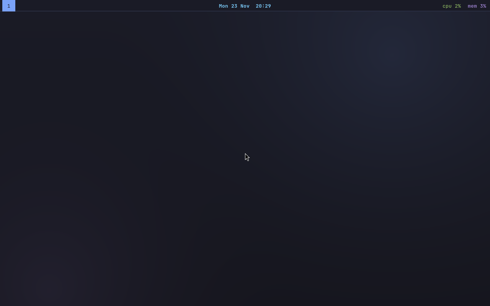

## Start it

On the page, pick the omarchy distro. GL is on by default with the display, so niri renders on the host's GL through virgl (`?gl=0` turns it off). At the console, run:

```sh
omarchy desktop
```

On the CLI there is no virgl. `--gpu` gives the guest a virtio-gpu device with dumb buffers and no 3D:

```sh
node js/cli.ts --distro omarchy --display=1280x800 --gpu
```

Then run `omarchy desktop` at the console. `niri-session` picks the renderer: virgl when the GPU device has the feature, `kms_swrast` otherwise. Super+Shift+E leaves the desktop (niri asks first).

The lock needs a password: set one at the console with `sudo passwd user`. Without one, the lock refuses and says so.

## What is in it

| Part | Package or source | Version |
| --- | --- | --- |
| Compositor | niri, cross-compiled for arm64 (`build-niri.sh`, 21.5 MiB) | 26.04 |
| Top bar | waybar | 0.12.0 |
| Wallpaper | swaybg, with a Tokyo Night gradient from `wallpaper.py` | 1.2.1 |
| Launcher | fuzzel | 1.12.0 |
| Notifications | mako (`mako-notifier`) | 1.10.0 |
| Lock | swaylock, a flat Tokyo Night fill | 1.8.2 |
| Terminal | foot | 1.21.0 |
| Screenshots, clipboard | grim, slurp, wl-clipboard | 1.4.0, 1.5.0, 2.2.1 |
| Seat and input | seatd, libinput | 0.9.1, 1.28.1 |
| Graphics | Mesa: EGL, GBM and GLES, with virgl or kms_swrast | 25.0.7 |
| Shell and tools | bash, starship, zoxide, fzf, ripgrep, fd, bat, eza, jq, git | 5.2.37, 1.22.1, 0.9.7, 0.60.3, 14.1.1, 10.2.0, 0.25.0, 0.21.0, 1.7.1, 2.47.3 |
| Editor, multiplexer, tools | neovim, tmux, lazygit, btop | 0.10.4, 3.5a, 0.50.0, 1.3.2 |
| Fonts, cursor | JetBrains Mono, DMZ-White | 2.304, 0.4.5.2 |

The versions are the image's dpkg versions, except niri's, which is `niri --version`: niri is not a Debian package. Its binary is built from the `NIRI_TAG` in `build-niri.sh`.

## Keys

`omarchy keys` prints the list (`/usr/share/omarchy/keys` in the image). Super is the Windows or Command key. The bindings follow Omarchy's keys. niri has no split direction, stacked layout, parent container, scratchpad or resize mode, so its column widths and presets (Super+R), tabs (Super+S) and window heights (Super+Ctrl+Up, Down) take their place.

| Keys | Action |
| --- | --- |
| Super+Return | terminal (foot) |
| Super+Space | launcher (fuzzel) |
| Super+Alt+Space | the omarchy menu |
| Super+W, Super+Shift+Q | close the window |
| Super+H J K L, or the arrows | focus left, down, up, right |
| Super+Shift+H J K L, or the arrows | move the column or the window |
| Super+Ctrl+Left, Right | the column's width, narrower or wider |
| Super+Ctrl+Up, Down | the window's height, shorter or taller |
| Super+R | the column's next preset width (a third, a half, two thirds) |
| Super+1 .. 0 | workspace 1 .. 10 |
| Super+Shift+1 .. 0 | move the window to workspace 1 .. 10 |
| Super+Tab | the previous workspace |
| Super+F, Super+T, Super+S | fullscreen, floating or tiled, the column's windows in tabs |
| Print | screenshot of the whole screen, to `~/Pictures` and the clipboard |
| Super+Shift+S | screenshot of a region (drag with the mouse) |
| Super+N | dismiss the notification |
| Super+Escape, Super+Ctrl+L | lock the screen |
| Super+Shift+/ | niri's hotkey overlay, which lists the bindings |
| Super+Shift+E | leave the desktop |

The configuration is `~/.config/niri/config.kdl`; niri reloads it when the file changes.

## The menu and the commands

`omarchy` lists its commands: `desktop` (or `start`), `menu`, `keys`, `install PKG...`, `update`, `lock`, `screenshot [region|output]` and `version`. Super+Alt+Space opens the menu in a floating window: Terminal, Launcher, Editor, Git (lazygit), System monitor (btop), Install a package, Update the system, Keybindings, Screenshot, Lock the screen, Restart, Shut down and Exit the desktop. Shut down runs `sudo poweroff`.

## The bar

The bar is waybar, configured in `~/.config/waybar` (`config` and `style.css`, Tokyo Night). It is a 30-pixel layer-shell bar at the top with the workspaces and the focused window's title (niri's modules), the clock (`Mon 23 Nov  20:29`), and the CPU and memory, refreshed every two seconds.

The bar was chosen by measurement against Quickshell 0.3.0 (the Debian trixie-backports package with its Qt 6 closure, and a QML bar with the same contents). Both ran in the same harness, in the page with virgl at 1280x800, one run each on 2026-11-23:

| | waybar 0.12.0 | Quickshell 0.3.0 |
| --- | --- | --- |
| Packages the bar adds to the niri base (dependency closure, installed size) | 74 packages, 107.7 MiB (the closure's other 16 packages, systemd among them, are not installed) | 145 packages, 283.1 MiB (Quickshell alone: 78 packages, 188.5 MiB; the rest are the QML modules and media libraries the spike's config imports) |
| Bar process started, after `omarchy desktop` | 4.7 s | 4.9 s |
| Bar on screen, after `omarchy desktop` | 8.0 s | 9.4 s |
| Bar's own start, process to on screen | 3.6 s | 4.9 s |
| Bar memory (RSS), idle | 43.5 MiB | 127.9 MiB, and a 13.3 MiB niri helper |
| Bar CPU, idle, over 10 s | 1.3 % | 3.2 % |
| Frames shown per second, 8 s of focus moves | 19.4 | 11.6 |
| Frames shown per second, 8 s of window moves | 21.0 | 20.1 |

An earlier pair of runs with the same harness gave the same order: on screen at 8.9 s (waybar) and 10.0 s (Quickshell), focus moves at 19.9 and 11.8 frames per second, window moves at 20.3 and 19.6.

waybar is the bar. It is smaller on every measure: its closure is about 2.6 times smaller in installed size, its memory about a third and its CPU less than half, it is on screen sooner, and it keeps about 20 frames per second in focus moves, where Quickshell drops to about 12. Its workspace, window-title, clock and CPU and memory modules are built in, so the bar is a config and a stylesheet. Quickshell would suit a bar with custom QML widgets, which this one does not need.

## Size

`omarchy.erofs` is 236,515,328 bytes (225.6 MiB), with 362 dpkg packages installed in 759.2 MiB. The niri binary (21.5 MiB) is not a Debian package; it is built by `build-niri.sh`.

## Speed and memory

Measured in the page with virgl at 1280x800, 2026-11-23, one run; the bar's numbers are in the table above.

- The compositor's socket is up 1.2 s after `omarchy desktop`. The bar process starts at 4.7 s and the bar is on screen at 8.0 s. The compositor and the bar's process come up in a few seconds; the first bar frame takes about 8 s under emulation, of which the bar's own start is 3.6 s.
- Idle memory (RSS): niri 138.0 MiB, waybar 43.5 MiB, mako 13.2 MiB, swaybg 7.4 MiB, and 12 to 13 MiB for each foot window.
- Motion: 19.4 frames per second in 8 s of focus moves, 21.0 in 8 s of window moves.
- The CLI (no virgl), measured once at 1280x800: the socket at 1.4 s, the bar process at 5.5 s, the bar on screen at 13.9 s, and niri at 158.8 MiB. The software path is CPU-bound, so the CLI's screenshots lag the keys they follow.

## Shutdown

`sudo poweroff` stops the desktop and powers the guest off; the menu's Shut down runs the same command. The kernel reports `halt (code 0)` about half a second later: 0.52 to 0.58 s in all five page runs, and in both CLI runs.

A scripted CLI run can end before its last command runs. The CLI sends the text it is given, and the shell runs a line only when its Enter arrives. `--input "$(cat script)"` drops the file's trailing newlines, so a final `poweroff` is echoed and never runs, and the CLI times out. A controlled pair showed it: the same script with its newline kept halted the guest, and without the newline the CLI timed out after 45 s with `poweroff` echoed. Keep the newline: `--input "$(cat script)"$'\n'`.

## Verification

The screenshots come from the page with virgl at 1280x800. The check boots the image, starts the desktop as `user` and drives it with the page's keyboard: the launcher, the menu, a notification, two tiled terminals, nvim, btop (fullscreen and in a half tile), lazygit, the lock, a wrong password, the right password, a Print screenshot, 8 s of focus moves and 8 s of window moves, and `sudo poweroff` at the end.

| | |
| --- | --- |
| 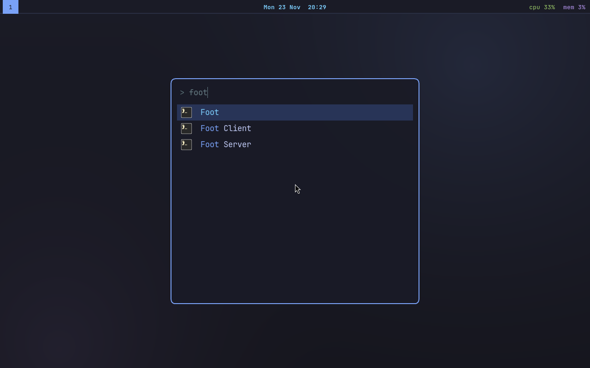 | 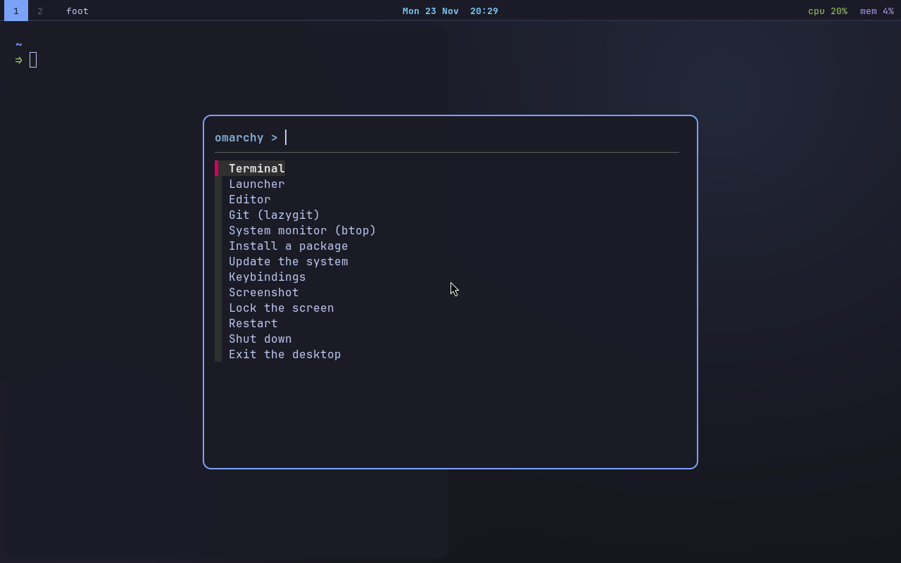 |
| The launcher (Super+Space) | The omarchy menu (Super+Alt+Space) |
| 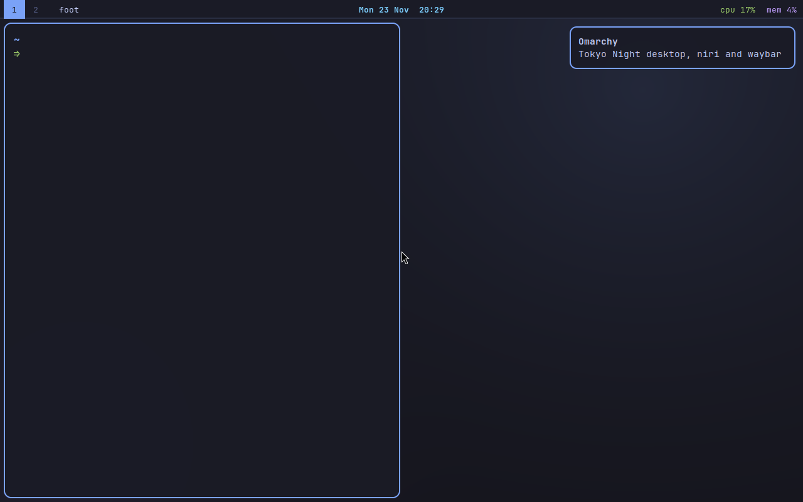 | 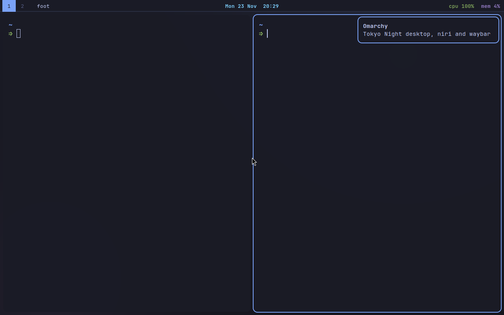 |
| A mako notification at the top right | Two foot windows, tiled, with 8-pixel gaps and the focus ring |
| 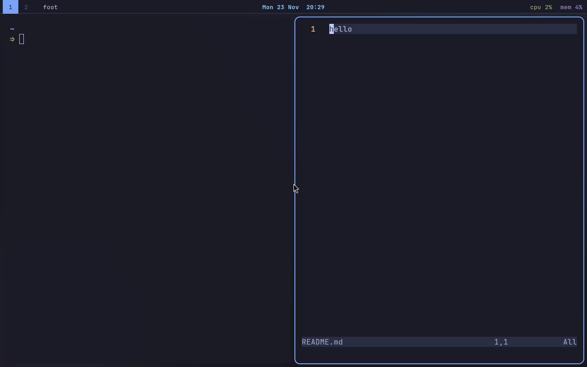 | 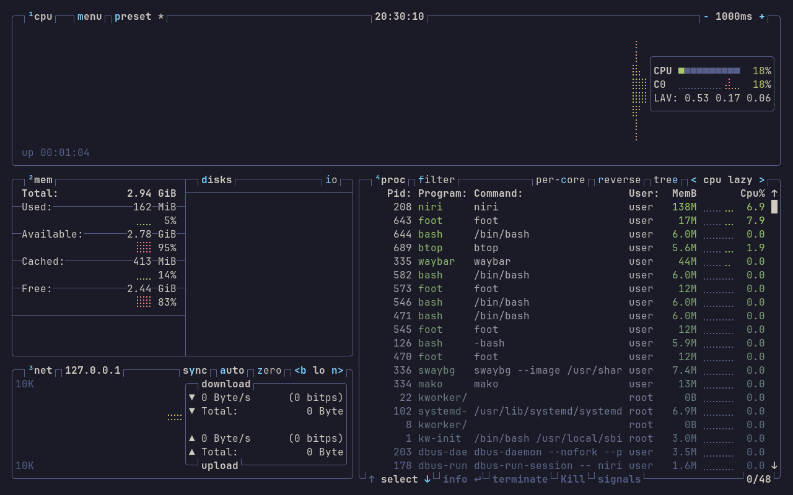 |
| nvim in a tile | btop, fullscreen |
| 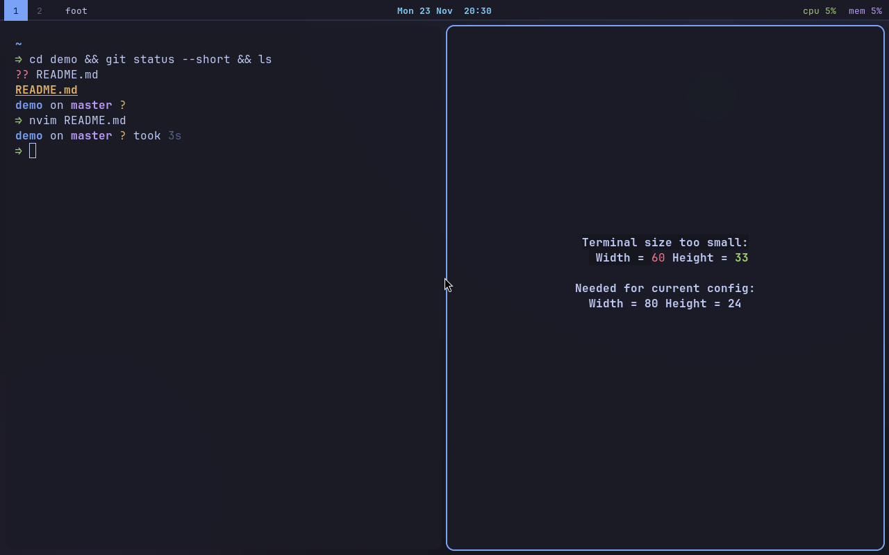 | 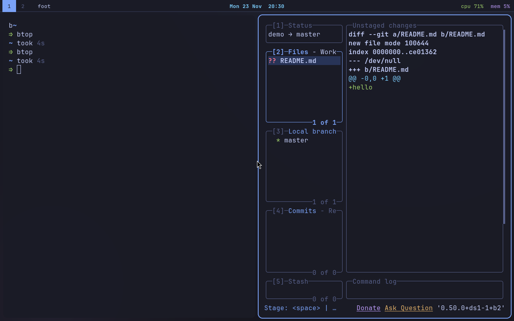 |
| btop in a half tile: the tile is 60 columns, too narrow | lazygit, with no first-run popup |
|  | 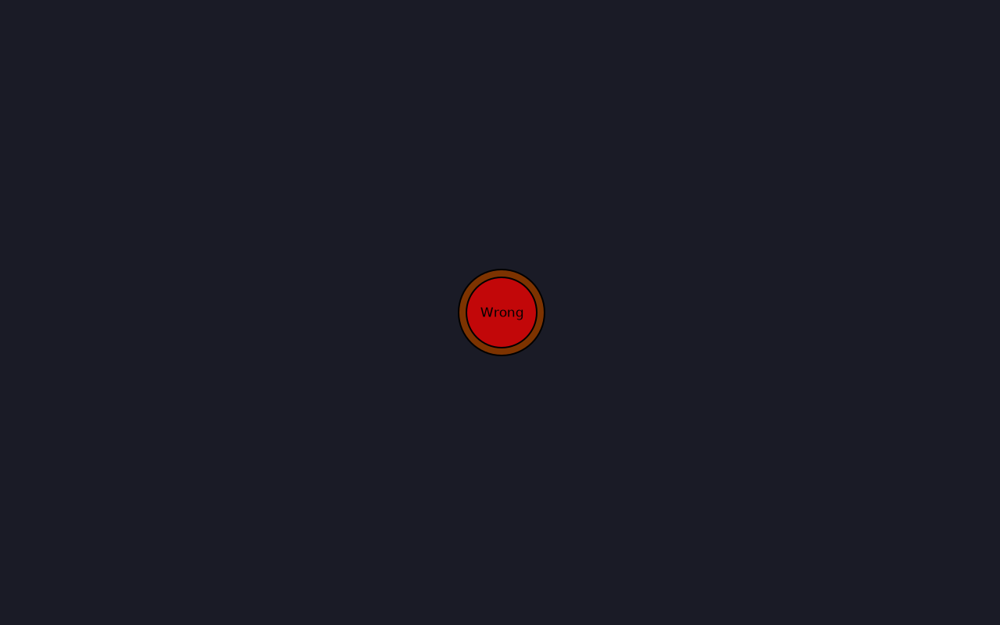 |
| Locked: a flat Tokyo Night fill | A wrong password: the ring turns red and reads Wrong |
| 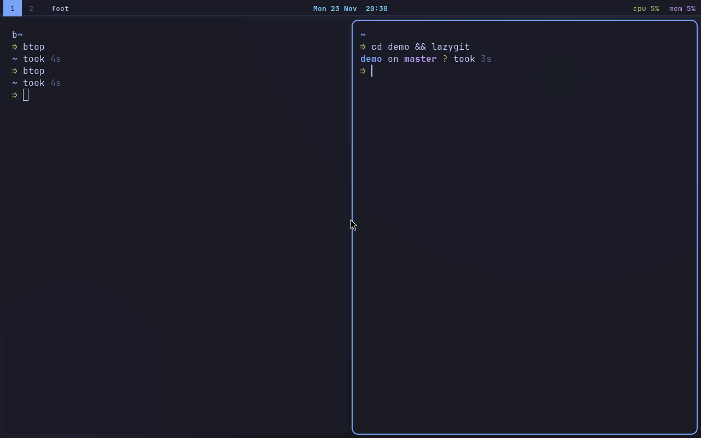 | |
| Unlocked again | |

The CLI (no virgl) runs the same desktop on the software rasterizer; the console shows `[drm] features: -virgl`, so niri took `kms_swrast`. In that run the bar came up, a terminal and the omarchy menu opened, and notifications showed. The first `omarchy lock`, before a password was set, was refused with a notification, as intended. After a password was set, the lock held and the password unlocked the desktop. niri then quit, and the guest powered off with `halt (code 0)`. The frames lag the keys because the emulated CPU is saturated, so some show an intermediate state:

| | |
| --- | --- |
| 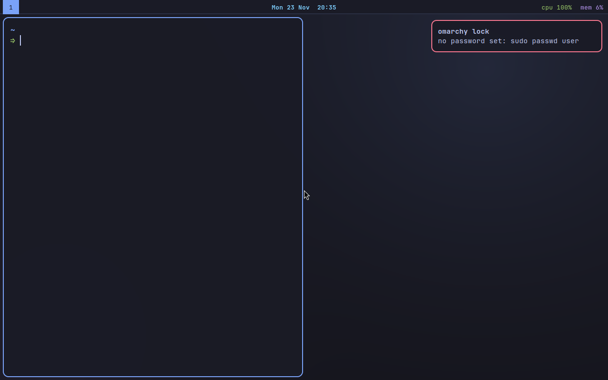 | 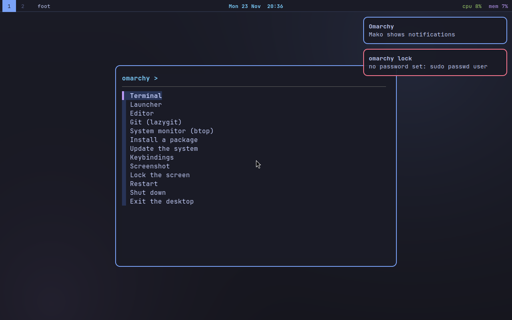 |
| A terminal on kms_swrast, with the notification from the refused lock | The omarchy menu, after the unlock |

## Limits

- btop needs 80 columns. A half tile at 1280x800 is 60 columns, and btop says the terminal is too small there. Fullscreen (Super+F) works.
- There is no Xwayland. The image has no `xwayland-satellite`, so niri logs that it cannot spawn it (Permission denied) and disables its X11 integration; X11 programs do not run. At start niri also warns that its login1 and locale1 D-Bus watchers fail, since there is no systemd. Neither warning does harm.
- The lock is plain: a flat Tokyo Night fill, with swaylock's ring that shows while a password is typed and turns red on a wrong one. There is no clock or other content.
- The bar has no tray, network, battery or audio module.
- There is no sound server and no Nerd Font. The network tools are curl, git and iproute2.
- The first bar frame comes about 8 s after `omarchy desktop` on the page and about 14 s in the CLI, where the emulated CPU is the bottleneck. The compositor's socket is up in 1.2 to 1.4 s.

## Build

```sh
kernel/build.sh base                  # the base bundle the apt steps boot (once)
distros/omarchy/build.sh              # vendor/build/distro/omarchy.erofs, omarchy.id
guest/build.sh index                  # distros.json, with KW_DISTRO_OUT set to the image's directory
```

`build.sh` builds niri first when `vendor/build/niri-arm64/niri` is missing (`build-niri.sh`). That script needs the arm64 cross toolchain (`gcc-aarch64-linux-gnu`, `libc6-dev-arm64-cross`), `rustup` with the stable toolchain, `libclang` for bindgen (`LIBCLANG_PATH`, default `/usr/lib/llvm-22/lib`), and python3, xz and dpkg-deb. Its libraries come from the pinned trixie `-dev` packages (`guest/distro/debian/pins.sh`). With niri built, the image build takes about nine minutes here.

| Variable | Effect |
| --- | --- |
| `KW_NIRI_BIN=FILE` | use a niri built elsewhere |
| `KW_DISTRO_TRACE=1` | record `boot-files` and `warm-files` again, after a change to what a boot or the first commands read |
| `KW_DISTRO_OUT=DIR` | write the image and its staging tree in `DIR` |
| `KW_OMARCHY_APT_CACHE=0` | no apt cache in the image (no boot at build time) |
| `KW_RELEASE=1` | a release build: the pinned wlandr relay only |
| `KW_WLANDR=FILE` | a local wlandr, for development (refused with `KW_RELEASE=1`) |

The packages are in `pins.sh` (`OMARCHY_PACKAGES`, installed with no recommends); adding one is adding its name there.

`.github/workflows/omarchy-image.yml` runs by hand (`workflow_dispatch`) or from another workflow (`workflow_call`). It caches the niri binary by the pins it is built from. With `release` set, it publishes `omarchy.erofs`, `omarchy.erofs.sha256` and `distros.json` as a GitHub release under the tag `omarchy-<YYMMDD>-<commit>`, never a `v*` tag.

| Path | What |
| --- | --- |
| `build.sh`, `build-niri.sh`, `resolve-debs.py` | the image, niri and the libraries niri links |
| `pins.sh` | the packages on top of the Debian base |
| `wallpaper.py` | the Tokyo Night wallpaper: a gradient the script generates (no third-party image) |
| `rootfs/etc/skel` | the user's files: niri, waybar, mako, foot, fuzzel, lazygit, neovim, btop, tmux, starship, bat, and the user's `README` |
| `rootfs/usr/local/bin` | `omarchy`, `niri-session`, and the `bat` and `fd` names |
| `rootfs/usr/share/omarchy/keys` | the keys `omarchy keys` prints |
| `rootfs/etc/init.d/omarchy` | the desktop's runtime: udev, the user's runtime directory, the machine id |
| `boot-files`, `warm-files` | what a boot and the first commands read, for the page's prefetch |
| `screenshots/` | the screenshots above |
